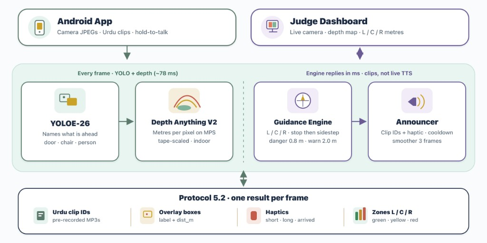

<div align="center">

# Raahi · راہی

**Real-time indoor navigation for visually impaired people, in Urdu and English.**

*Raahi (راہی) means "traveller". A phone camera sees the way; Raahi speaks it.*

</div>

---

## Overview

White canes sense about a metre ahead at ground level, and GPS apps stop working at the door. Indoors (universities, hospitals, offices) a visually impaired person still has to guess where the chair, the open door or the person in the corridor is.

Raahi turns any Android phone into a guide. The phone streams its camera to a Raahi server. The server **recognises objects**, **measures how far away they are**, decides the safest way forward and answers with short spoken instructions in a natural female voice, in **Urdu or English**:

> *"کرسی سامنے ہے، دو قدم پر۔ دو قدم بائیں ہٹیں۔"*
> *"Chair ahead, two steps away. Move two steps left."*

The whole app can be used without looking at the screen. Say **"Raahi"** followed by a command to open any screen, change settings or control guidance, in Urdu, Roman Urdu or English.

Raahi complements the white cane; it does not replace it.

## Key features

| | Feature | What it does |
|---|---|---|
| 🦯 | **Obstacle guidance** | Continuous warnings with the object's name, its distance in steps and which way to step to avoid it. Unnamed obstacles (walls, boxes) are caught by depth estimation. |
| 🛑 | **Danger stop** | Anything within about 0.8 m triggers an immediate spoken "Stop!", always followed by a way out (step left, right or back), plus a long vibration. |
| 🗣️ | **Bilingual voice** | Every instruction is recorded in Urdu and English (ElevenLabs Eleven v3, one consistent female voice), so playback starts instantly with no text-to-speech delay. Switch language at any time. |
| 🎙️ | **Full voice control** | "Raahi, settings kholo", "Raahi, dark mode", "Raahi, start detecting", "Raahi, English mein bolo". Speech is recognised by ElevenLabs Scribe v2 Realtime and matched **on the phone** with no server round trip, so commands act as soon as they are heard. Works hands-free or by long-press. |
| 🔎 | **What's ahead?** | A one-shot spoken description of the nearest objects with direction and distance. |
| 🚪 | **Find mode** | Guides the user to a door, chair, table, sofa, trash bin or person: turn left/right, steps remaining, "you have reached the door". |
| 📱 | **Accessible by design** | TalkBack labels on every control, high-contrast theme, adjustable text size, large controls, haptic patterns, light/dark themes, and an orientation gate that asks the user to hold the phone upright. |
| 🖥️ | **Judge dashboard** | Live camera with detection boxes, colour depth map, left/centre/right zone distances, the sentence being spoken and per-stage latency. |
| 🔒 | **Privacy** | No accounts. History is stored on the phone only. The ElevenLabs API key never leaves the server; the phone uses single-use tokens. |

## Architecture



Each camera frame goes through object detection and depth, then the guidance engine and announcer. The reply is one Protocol 5.2 result: Urdu clip IDs, overlay boxes, haptics, and left / centre / right zones. The judge dashboard shows the live camera, depth map, and those distances.

## How it works

```
 Android phone                                  Raahi server (FastAPI)
 ─────────────                                  ─────────────────────
 CameraX frame (upright, 416 px JPEG) ───WS───▶ YOLOE-26 object detection ─┐
                                                Depth Anything V2 (metres) ─┤
                                                                            ▼
                                                Guidance engine
                                                  · left / centre / right zones
                                                  · nearest obstacle, distance in steps
                                                  · safest side + steps to move
                                                  · find / describe modes
                                                  · smoother + announcer (no repeats,
                                                    stop once, then the way out)
 Plays prerecorded clips (Urdu / English) ◀──WS── clip ids: ["obj_chair","pos_ahead",
 vibrates on danger                               "steps_2","move_left_2"]
 Mic ─▶ ElevenLabs Scribe ─▶ on-device command matcher ─▶ navigation / settings / guidance
```

**Why prerecorded clips?** Guidance has to be in sync with what the camera sees. Live text-to-speech adds hundreds of milliseconds and needs the network. Raahi assembles sentences from about 100 short recorded phrases per language (object, position, distance, action), so audio starts as soon as a decision is made. A cached live-TTS fallback covers rare labels.

**Why fuse depth and object size?** Monocular depth is excellent at room scale but unreliable very close to the camera. Raahi combines the depth map with each detected object's known real-world size (height, or width when the object is cut off by the frame) and keeps the closer estimate, so a person standing right in front of the camera is never reported as "path clear".

## Tech stack

| Layer | Technology |
|---|---|
| Object detection | Ultralytics **YOLOE-26** (open-vocabulary), 28 indoor classes baked in and exported to ONNX / LiteRT (TFLite) / CoreML |
| Depth | **Depth Anything V2** Metric Indoor Small (Hugging Face Transformers; PyTorch MPS / CPU, CoreML fallback) |
| Server | Python, **FastAPI**, WebSockets, OpenCV, NumPy |
| Voice | **ElevenLabs** Eleven v3 (Urdu + English clips), **Scribe v2 Realtime** (speech-to-text), live TTS fallback |
| Android | **Kotlin**, **Jetpack Compose**, CameraX, OkHttp WebSockets, DataStore, kotlinx.serialization |
| Training | Kaggle / Colab notebooks: export, plus optional fine-tuning on COCO + Open Images + venue photos |

## Repository structure

```
Raahi/
├── backend/
│   ├── server/
│   │   ├── main.py              FastAPI app: /ws (phone), /dashboard, /health, /calibrate
│   │   ├── perception/          detector.py (YOLOE), depth.py (Depth Anything V2), sizes.py
│   │   ├── engine/              navigator, find mode, describe, smoother, announcer, geometry
│   │   ├── voice/               intents, Scribe token, live TTS, app command reference
│   │   ├── dashboard/           judge dashboard (HTML + live WebSocket)
│   │   └── mocks/               mock detector / server for offline development
│   ├── voice_assets/            Urdu + English clip library, batch splitter, sentence composer
│   ├── shared/classes.json      detector classes, sizes and clip mapping (single source)
│   ├── models/                  exported detector models
│   ├── training/                export + fine-tuning notebooks
│   ├── tools/                   live laptop demo, benchmarks, calibration, model export
│   └── tests/                   pytest suite (engine, voice, commands, server)
├── frontend/
│   ├── android/                 native Android app (Kotlin + Jetpack Compose)
│   └── web-prototype/           early web prototype and on-device detector plugin
└── docs/                        project plan, protocol contracts, design notes
```

## Getting started

### Backend

Requires Python 3.11+.

```bash
cd backend
python -m venv .venv && source .venv/bin/activate     # Windows: .venv\Scripts\activate
pip install torch torchvision                          # CPU-only machines: add --index-url https://download.pytorch.org/whl/cpu
pip install -r requirements.txt
cp .env.example .env                                   # add ELEVENLABS_API_KEY and ELEVENLABS_VOICE_ID
python tools/download_models.py                        # depth weights (once)
python -m server                                       # phone: ws://<server-ip>:8000/ws
```

- Dashboard: `http://<server-ip>:8000/dashboard`
- Tests: `python -m pytest`
- Laptop demo without a phone (webcam, depth, guidance, voice): `python -m tools.live_demo --lang en` (or `--lang ur`)

### Android app

1. Open `frontend/android/` in Android Studio (JDK 17).
2. Build and run on a phone on the same network as the server.
3. In the app go to **Settings › Connection** and enter `http://<server-ip>:8000`, then **Test connection**.
4. Grant camera and microphone access during onboarding.

## Voice commands

Start with **"Raahi"** (hands-free) or long-press anywhere (no wake word needed).

| Say (Urdu / Roman Urdu / English) | Action |
|---|---|
| "سیٹنگز کھولو" · "settings kholo" · "go to settings" | Open Settings (also: accessibility, voice settings, history, help, privacy, about…) |
| "واپس جاؤ" · "go back" · "go home" | Navigate back / home |
| "ڈارک موڈ" · "dark mode" · "light mode" | Change theme (also high contrast, bigger/smaller text) |
| "انگلش میں بولو" · "switch to Urdu" | Change the guidance voice language |
| "آواز تیز کرو" · "louder" · "speak slower" | Volume and speech speed |
| "شروع کرو" · "start detecting" | Start guidance |
| "رک جاؤ" · "pause" · "jari rakho" · "band karo" | Pause / resume / stop guidance |
| "سامنے کیا ہے" · "what's ahead?" | Describe the surroundings |
| "دوبارہ بولو" · "repeat" | Repeat the last instruction |

The vocabulary is a single file (`frontend/android/app/src/main/assets/voice_commands.json`). New phrases can be added without code changes.

## Team

| Contributor | Role | Contribution |
|---|---|---|
| **Esha Shabbir** | Detection & Voice AI | YOLOE-26 object detection (class design, export to ONNX/TFLite/CoreML, training notebooks); Urdu and English voice system (ElevenLabs clip library, batch recording pipeline, sentence assembly); Scribe speech recognition; bilingual voice-command and voice-navigation engine; live TTS fallback; guidance tuning and the laptop demo |
| **Uswa Khan** | Depth & Judge Dashboard | Depth Anything V2 metric depth (MPS/CoreML, calibration); depth-based navigation zones and server; the live judge dashboard with detections, depth map, zones and latency |
| **Abeera Amir** | Mobile App & Frontend | The native Android app end to end: all screens and flows (onboarding, guidance, find, what's ahead, history, settings, accessibility, diagnostics, errors), design system, camera streaming, audio playback, haptics and accessibility |

## Roadmap

- Fully on-device mode (detection already exports to LiteRT/TFLite)
- Stairs and drop-off detection
- Outdoor navigation
- More languages (Punjabi, Pashto, Sindhi)
- Partnerships with schools and organisations for the visually impaired

---

<div align="center">

**Raahi · راہی**: seeing the way, together.

</div>
